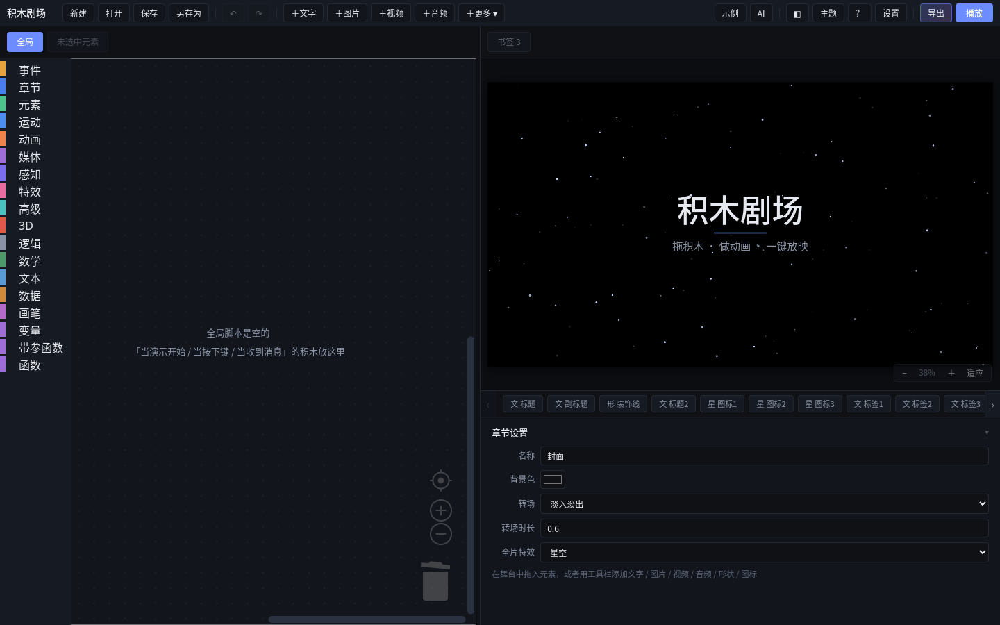
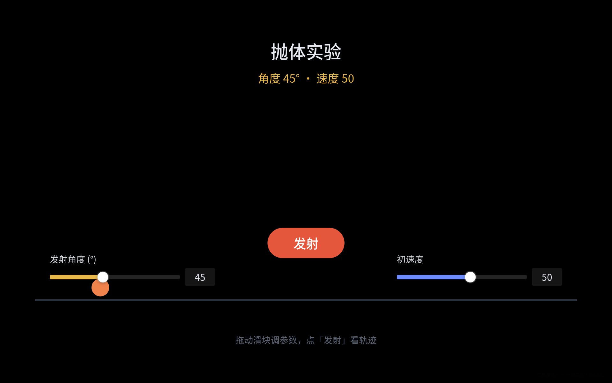
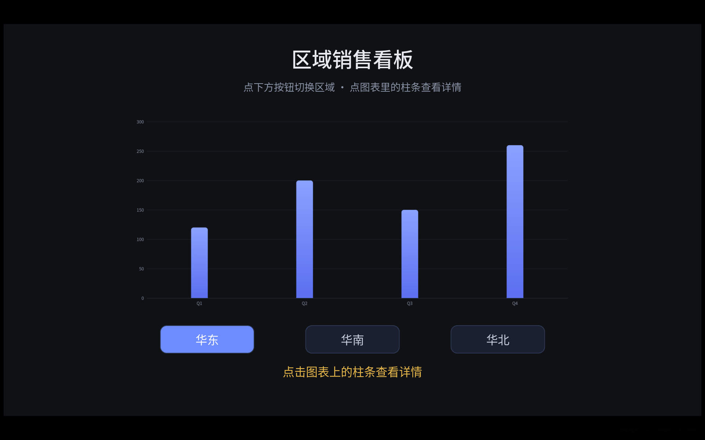
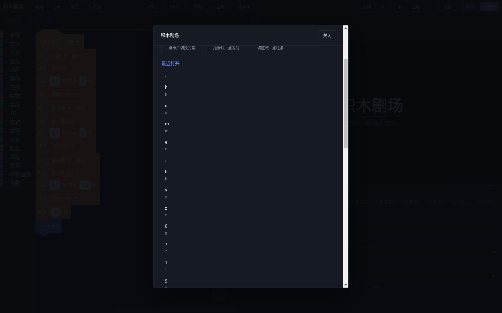

# 积木剧场 Jimuchang

<p align="center"></p>

用图形化积木编排**交互式演示**——Scratch 的手感、PPT 的舞台、网页的交互。

拖积木定义演示流程；放映时观众可以点击、拖动、调参数参与其中；一键导出为单个网页放映包（可交互）/ PPT / MP4 / Windows 程序，发给任何人双击即看。



## 下载

| 平台 | 方式 |
|---|---|
| Windows 10/11 (x64) | [Releases](https://github.com/YanZhen-Huang/jimuchang/releases) 下载 `Jimuchang-Setup-*.exe` 安装 |
| Linux | 见下方「从源码构建」（Deepin 25 + Qt 6.8 实测） |
| 只看演示 | 让对方导出「网页放映包」——单个 .html 或 .exe，双击即放，无需安装 |

## 功能

- **交互演示**：滑块调参数、点卡片切换、点图表柱条看详情、悬停反馈——观众能上手玩
- **11 种元素**：文字 / 图片 / 视频 / 音频 / 形状 / 图标 / 滑块 / 图表 / 帧动画 / 3D 模型 / 网页小程序
- **174 块中文积木**：事件 / 章节 / 元素 / 运动 / 外观 / 动画 / 克隆 / 媒体 / 侦测 / 数学 / 文本 / 数据 / 画笔 / 3D / 特效 / 逻辑 / 函数；每个元素都能拥有独立脚本
- **积木 / 章节双模式**：章节模式用可视化流程设置显隐、动画、等待和跳转，并自动生成对应积木；积木模式可继续精细编辑
- **素材区**：图片 / 音频 / 视频 / 3D / HTML 统一入库、搜索筛选、改名、引用检查；拖到舞台即可插入
- **三层动画**：20 种入场预设 → 积木命令 → 关键帧编辑器
- **导出与分享**：单文件 HTML 放映包（可交互、手机可看）/ PPT（可编辑 + 高保真）/ PDF 讲义 / MP4 录制 / Windows 单文件程序
- **与本地数据联动**：图表可从 CSV 导入；放映包支持外置数据文件 `jimuchang-data.js`，改数据不用改 HTML；`.bdp` 项目双击直接打开
- **AI 助手**：一句话生成演示；另有本地 HTTP API + MCP 服务器供外部 AI 驱动

## 三个「点开就能玩」的模板

| 报价单 | 抛体实验 | 数据看板 |
|---|---|---|
|  |  |  |

点卡片切换价格方案；拖滑块调角度速度、点发射看小球抛物线（带轨迹线）；点按钮切区域、点柱条看详情。

主页模板库共 7 个模板：



## 快速开始

### Windows

下载安装包 → 安装 → 打开即可。个别功能（导出视频）需要系统里有 `ffmpeg`。

### 从源码构建（Linux / macOS）

```bash
git clone https://github.com/YanZhen-Huang/jimuchang.git
cd jimuchang
cmake -B build -DCMAKE_BUILD_TYPE=Release
cmake --build build -j$(nproc)
./build/jimuchang
```

依赖：Qt 6.8（Widgets / WebEngineWidgets / WebChannel / HttpServer / WebSockets）、CMake 3.16+、C++17 编译器。
前端依赖（Blockly / Three.js / ECharts / JSZip）已内置在 `web/vendor/`，无需 npm。
Windows 安装包由 GitHub Actions 自动构建（`.github/workflows/windows.yml`）。

### 上手

1. 启动 → 主页选一个模板或「示例演示」→ 点「播放」全屏放映（空格推进、Esc 退出）
2. 顶部切换「积木 / 章节」：章节模式自动生成流程积木，积木模式可精细控制；工具栏「＋」添加元素
3. `Ctrl+S` 保存为 `.bdp` 单文件项目

详细说明见 [docs/使用文档.md](docs/使用文档.md)，设计细节见 [docs/技术文档.md](docs/技术文档.md)。

## AI 接口（可选）

本地 API 默认关闭，需要在「设置 → 高级」手动开启；只监听 `127.0.0.1`，令牌见 `~/.config/jimuchang/api.json`（权限 600）。
配合 MCP 服务器（`tools/jimuchang-mcp`），支持 MCP 的 AI 客户端（opencode / Codex 等）可以直接：

```
你：用积木剧场做个介绍太阳系的演示
AI：（调用 35 个 MCP 工具）建章节 → 查/传素材 → 放元素 → 写积木脚本 → 截图自检 → 导出放映包
```

## 项目结构

```
jimuchang/
├── src/                # C++ 外壳（Qt6 WebEngine 壳 + 文件/全屏桥 + HTTP API 服务器）
├── web/                # 前端（编辑器 + 舞台引擎 + 播放器）
│   ├── js/             #   easing / project / stage / elements / animations /
│   │                   #   blocks / chapter-flow / asset-hub / executor / keyframes /
│   │                   #   effects / sprites / three-scene / jimu-api / player ...
│   ├── vendor/         #   Blockly / Three.js / ECharts / JSZip（内置）
│   └── assets/         #   内置 3D 模型等
├── packaging/windows/  # Windows 安装包脚本（Inno Setup）与图标
├── docs/               # 技术文档 / 使用文档 / 各期开发报告
└── CMakeLists.txt
```

## 技术要点

- **积木编译成 IR 指令**（不生成 JS），解释执行；导出放映包时预编译，播放器无需 Blockly
- **章节模式是同一条 IR 链的上游投影**：结构化流程确定性生成 Blockly JSON，不复制项目数据
- **安全默认**：本地 API 默认关闭，API / AI Key 配置文件仅当前用户可读写，文件桥限制扩展名与授权目录
- **qrc 单文件发布**：全部前端资源编译进可执行文件，运行时零外部依赖
- **qrc 下 fetch 不可用**的规避：3D 模型经 QWebChannel 读取 → ArrayBuffer → `GLTFLoader.parse`；导出包用 Blob URL 链解决 ESM 依赖
- **本地 API 回调模式**：绕过 `runJavaScript` 不解析 Promise 的限制，经 QWebChannel 回传结果
- **稳定的自动化测试**：`tools/test-regress.sh` 批跑 21 项内置钩子（渲染 / 交互 / AI / 素材 / 双模式 / 安全 / 导出等）

## 开发历程

| 阶段 | 内容 |
|---|---|
| P0 | 技术验证（WebEngine / Blockly / 视频 / 截图） |
| P1 | 核心闭环（编辑器 / 积木 / 播放 / 存取） |
| P2 | 媒体与特效（音视频 / 图表 / 帧动画 / 撤销重做） |
| P3-P6 | 关键帧 / 3D / AI 接口 / 导出放映包 |
| P7 | 打磨（辅助线 / 帮助页 / 浅色主题 / 性能） |
| R1-R4 | 元素中心重构（元素独立脚本 / 连续舞台 / 章节书签 / 广播 / 带参函数） |
| S1-S3 | 设置面板 / 积木补全 / 积木搜索 / 国庆主题 |
| v2.0.x | 新用户入口 / 画布缩放 / 可调布局 / 元素条溢出修复 / 导出视频 |
| v2.1.x | 交互三件套（滑块 / 图表 / 悬停）+ 三个交互模板 / 全局打磨（保存并退出等） |
| v0.3.0 | 版本号重编为 0.x 迭代线；示例打磨 / 本地文件联动 / Windows 安装包 |
| v0.3.1 | 去 emoji 设计收敛 / 最近文件修复 / Windows 安装包上架 |
| v0.4.0 | 细节功能：PDF 导出 / 播放激光笔 / 章节进度 / 复制粘贴 / 最近文件管理 / 窗口记忆 |
| v0.4.x 开发中 | 安全基线 / 积木·章节双模式 / 素材区 / MCP 与 AI 素材复用 |

各期详细报告见 [docs/](docs/)（[问题与改进清单](docs/问题与改进清单.md) 记录了每一轮"新用户走查"的修复过程）。

## 许可

[MIT](LICENSE) © 2026 YanZhen-Huang
